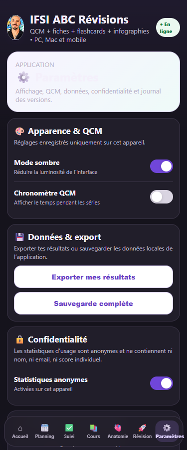
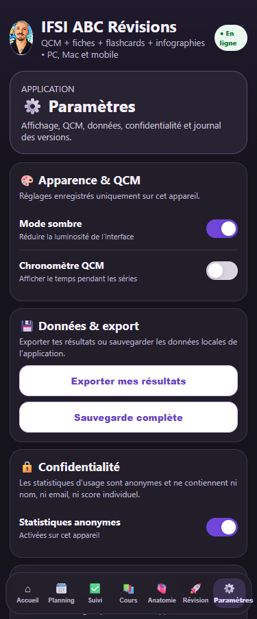

# Correctifs P1 — preuves avant / après

Comparaison du 18 octobre 2026 : `main` au commit `334b01d3f372799f435cc3cf3febcbd0c00ced29` (8.30.90), puis candidat 8.30.91. Le suivi des cours et du planning introduit par cette version est conservé. Aucune banque pédagogique, permission Drive ou configuration Supabase n’est modifiée.

## Résultats observés

| P1 / scénario | Avant | Après | Correction et test |
|---|---|---|---|
| P1-01 : pack QCM retardé après démarrage du registre | 686 QCM sans cours ; 1 117 flashcards | 0 sans cours sur 3 038 ; 1 355 flashcards et compteur actualisé | `course-registry-v741.js`, `v8338-flashcards.js` ; `late-bank-full-index` |
| P1-01 : reprise après échec d’un pack | 723 QCM sans cours après reprise | 0 sans cours ; 1 355 cartes | `partial-bank-retry` |
| P1-02 : entrée des exercices urinaires | Bouton présent mais masqué par le CSS | Entrée visible ; schéma 5/5, associations 4/4, retour accueil fonctionnel | `v86-home-clean.js` ; `urinary-exercises-visible-and-return` |
| P1-02 : rechargement hors ligne avec accueil encore en construction | Entrée masquée lorsqu’elle est directement sous `home` | Entrée visible dans les deux emplacements ; 3 038 QCM et 1 355 cartes accessibles | `offline-cached-revisions` |
| P1-03 : quatre fiches inaccessibles | Quatre liens actifs conduisant à un accès refusé lors de l’audit | Quatre mentions explicites d’indisponibilité ; 55 autres liens conservés | `resource-access-v1.js` ; `unavailable-drive-links-all-catalogues` |
| P1-04 : résultats individuels de maths | Un événement contenant des résultats est préparé pour le réseau | Aucun résultat envoyé ; progression locale conservée | `math-case-engine-v1.js`, `analytics-v77.js` ; `math-results-local-only`, `analytics-privacy-contract.mjs` |
| P1-05 : bandeau Paramètres sombre | Contraste titre 1,03:1 ; texte 1,85:1 | Titre 13,76:1 ; texte 8,68:1 à 320, 375 et 768 px ; contrôle accessible au zoom 200 % | `v87-settings.js` ; `settings-dark-contrast-and-widths` |
| P1-06 : couverture réelle des tests | Fixture préparant les identifiants avant l’audit ; 2 560 QCM seulement | Audit de 3 038 QCM dont 478 de vocabulaire ; scénario Chromium avec ordre de chargement réel | `flashcards-runtime-fixture.mjs`, `qcm-full-runtime-audit-v8374.mjs`, nouveau job CI `browser-p1` |

Le compteur de cartes dépendait de l’ordre des chargements. Les valeurs « avant » ci-dessus proviennent du scénario contrôlé avec le cinquième pack retardé, pas d’une valeur garantie à chaque ouverture.

## Protocole et preuves

Le même script `tests/browser-p1-regressions.mjs` est exécuté sur une copie exacte du commit de base puis sur la branche corrigée. Il utilise un profil Chromium neuf, le vrai Service Worker, un serveur statique local, un pack retardé, un échec HTTP 503 puis une reprise et un rechargement hors ligne. Les requêtes externes du navigateur sont interceptées ; les événements analytiques sont observés sans atteindre Supabase. Aucune navigation vers Drive, aucun partage, aucune fusion ni aucun déploiement.

- [Résultats avant](audit-p1-20261018/before-results.json) et [après](audit-p1-20261018/after-results.json) : sept scénarios en échec avant ; huit scénarios réussis après, dont l’absence d’erreur JavaScript.
- [Banque avant](audit-p1-20261018/before-late-bank.json) et [après](audit-p1-20261018/after-late-bank.json).
- [Contrôles locaux](audit-p1-20261018/checks.json) : 63 suites Node et 4 suites Python réussies ; syntaxe de 149 fichiers JS et 73 fichiers MJS contrôlée. Sous Windows, les deux fichiers soumis à empreinte exacte ont été lus avec les fins de ligne LF de Git pendant les tests, puis restaurés sans changement de contenu.
- [Accueil corrigé](audit-p1-20261018/after-home.png), [exercices corrigés](audit-p1-20261018/after-exercises.png), [écran 320 px](audit-p1-20261018/after-dark-320.png), [zoom 200 %](audit-p1-20261018/after-dark-zoom200.png).

| Paramètres avant | Paramètres après |
|---|---|
|  |  |

Le contrat analytics conserve uniquement les événements et types de ressources acceptés par la base existante. Les métadonnées ont une liste de clés d’usage autorisées, des limites de taille, et excluent scores, corrections et champs inconnus. Les contraintes ont été relues par une requête SQL en lecture seule ; aucune migration ou insertion n’a été effectuée pour ces tests. La limite locale de 800 caractères réserve la place des espaces ajoutés par la représentation JSONB (limite base : 1 000).

## Reproduire

```sh
pnpm install --frozen-lockfile --ignore-scripts
pnpm exec playwright install --with-deps chromium
pnpm test:browser
node tests/analytics-privacy-contract.mjs
node tests/qcm-full-runtime-audit-v8374.mjs
```

Pour la comparaison, définir `IFSI_TEST_ROOT` vers une extraction du commit de base, `IFSI_BROWSER_OUTPUT` vers un répertoire séparé et ajouter `--record-only`. Cette option enregistre les échecs attendus sans rendre la commande bloquante ; elle n’est jamais utilisée par le job CI. En CI Ubuntu, le canal Chrome utilise le profil système permettant de conserver `chromiumSandbox: true` ; le binaire headless-shell téléchargé ne peut pas démarrer avec les restrictions AppArmor du runner. Les captures et rapports complets de chaque exécution CI sont conservés 14 jours dans `browser-p1-evidence`.

## Limites et point encore ouvert

**P1-03 reste partiellement résolu.** Le défaut d’interface est traité ; l’accès aux quatre documents n’est pas restauré. Le propriétaire doit décider d’une réparation du partage ou fournir des liens utilisables, puis leur ouverture doit être vérifiée hors connexion propriétaire avant retrait de la liste d’indisponibilité. Aucun droit Drive n’a été modifié.

Le test de contraste cible le bandeau corrigé ; ce n’est pas une certification d’accessibilité de toute l’application. Le hors-ligne vérifie les révisions déjà mises en cache ; il ne rend pas les PDF Drive ou MP3 distants disponibles hors réseau. Ces résultats locaux ne valent ni validation sur un téléphone physique ni preuve de la future version déployée. La validité pédagogique exhaustive des 3 038 corrigés n’est pas établie par les tests structurels. Les autres constats P2 de l’audit restent hors de cette PR.
